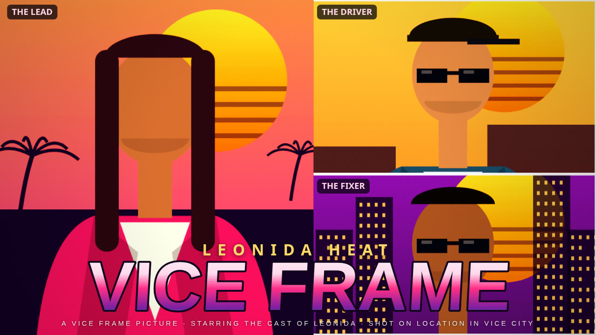
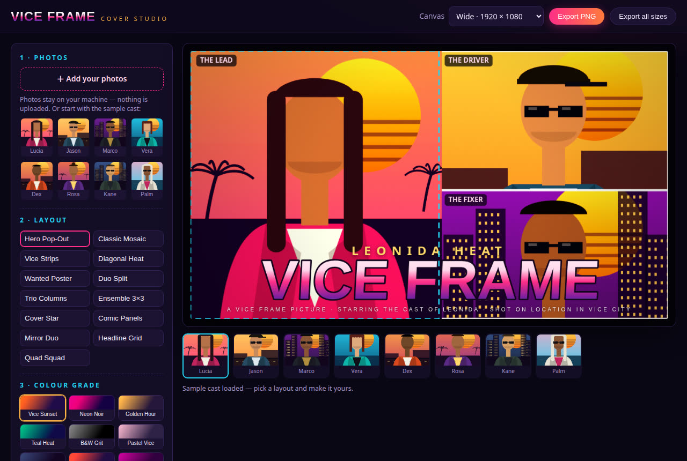
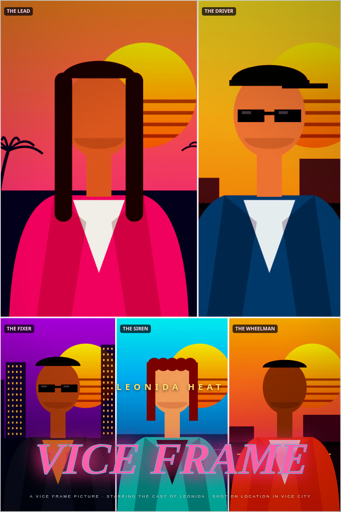

# VICE FRAME — Cover Studio

[](https://make.fun/bounty/gta6-cover-art-01?utm_source=github&utm_medium=readme&utm_campaign=gta6-cover-art-01)
[](https://make.fun/bounty/gta6-cover-art-01/leaderboard?utm_source=github&utm_medium=readme&utm_campaign=gta6-cover-art-01)
[](https://make.fun/bounty/gta6-cover-art-01?utm_source=github&utm_medium=readme&utm_campaign=gta6-cover-art-01)

An offline GTA-style cover art maker: drop in your own photos (or start
with the built-in sample cast), arrange them across multi-panel poster
layouts, grade the colours, set the lettering, and export a share-ready
PNG. Everything runs in the browser from static files — photos are read
on your own machine and never uploaded.



## What it does

- **13 layouts** — Hero Pop-Out (the lead photo breaks the top of its
  frame), Classic Mosaic, Vice Strips, Diagonal Heat with slanted
  polygon panels, Wanted Poster, Duo Split, Trio Columns, Ensemble 3×3,
  Cover Star, Comic Panels, Mirror Duo, Headline Grid and Quad Squad.
- **13 colour grades** — Vice Sunset, Neon Noir, Golden Hour, Teal
  Heat, B&W Grit, Pastel Vice, Midnight Chrome, Coral Heat, Ultra
  Violet, Mono Ink, Tropical Pop, Desert Dusk and Arctic Neon — each a
  filter chain plus a tint wash, with toggleable film grain and
  vignette.
- **4 lettering styles** — Chrome gradient, Neon script, Outline block
  and Retro wave — with editable title, subtitle, per-panel role tags
  and a movie-poster billing block.
- **Any photo** — upload your own (FileReader, on-device only) or use
  the 8 sample cast portraits drawn in code. Click a panel to select
  it, drag the photo inside it to reframe, zoom per panel, face-centre
  in one click (the focal anchor sits in the upper third, where faces
  live).
- **Export** — PNG rendered fresh at full resolution in four sizes:
  Poster 1200 × 1800, Square 1440 × 1440, Story 1080 × 1920 and Wide
  1920 × 1080, one at a time or all four at once.



## Run it

Serve `app/` with any static file server and open it in a desktop
browser — or use the bundled one:

```sh
node serve.ts   # http://localhost:8080
```

No build step, no dependencies, no network requests.

## Hand it in (make.fun)

`main.ts` is the entry program for the
[gta6-cover-art-01](https://make.fun/bounty/gta6-cover-art-01) bounty:
it stages `app/` and `screenshots/` into the output directory and
writes `dossier.json` with the vendored make.fun library.

```sh
mkdir -p out && MAKEFUN_OUTPUT_DIR=out node main.ts
```



## License

MIT — see [LICENSE](LICENSE). All artwork in the app and screenshots
is original and drawn in code; no third-party game artwork, logos or
fonts are used.
